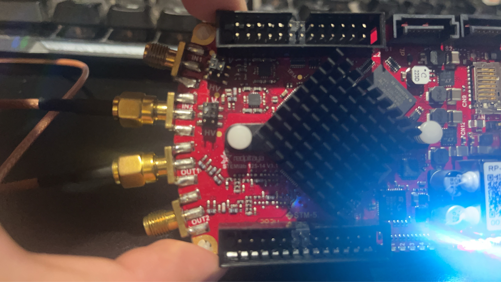
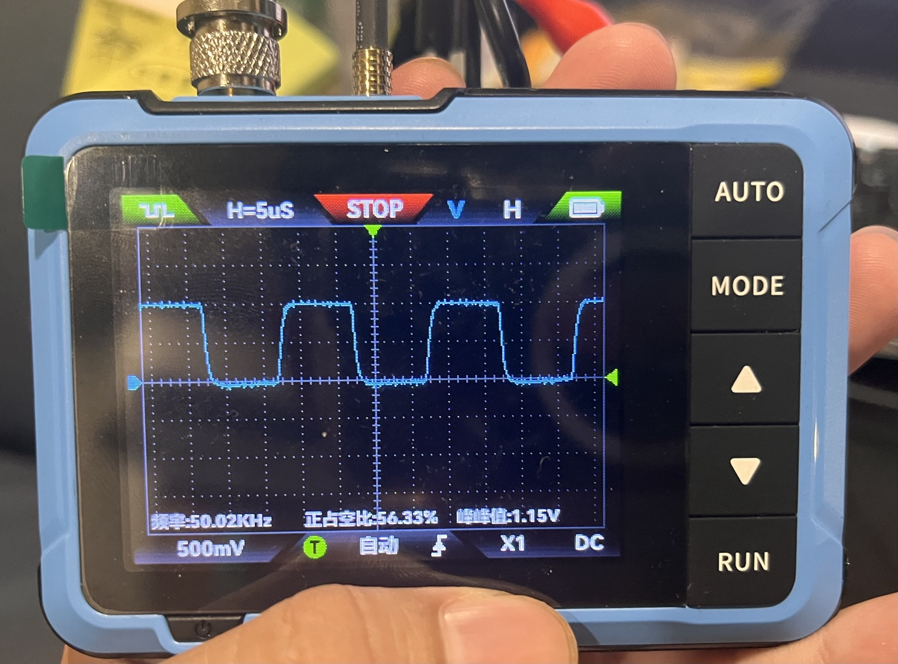
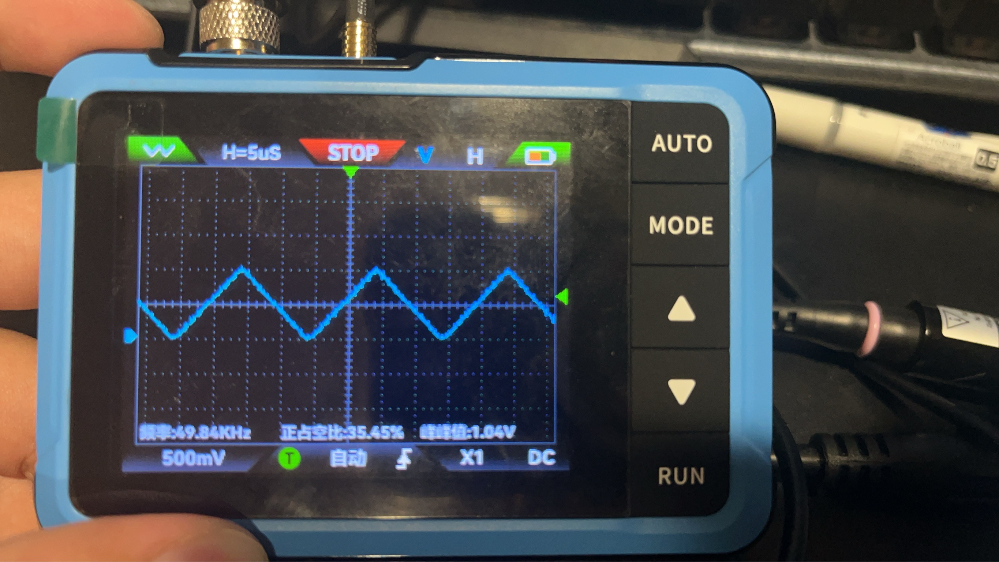
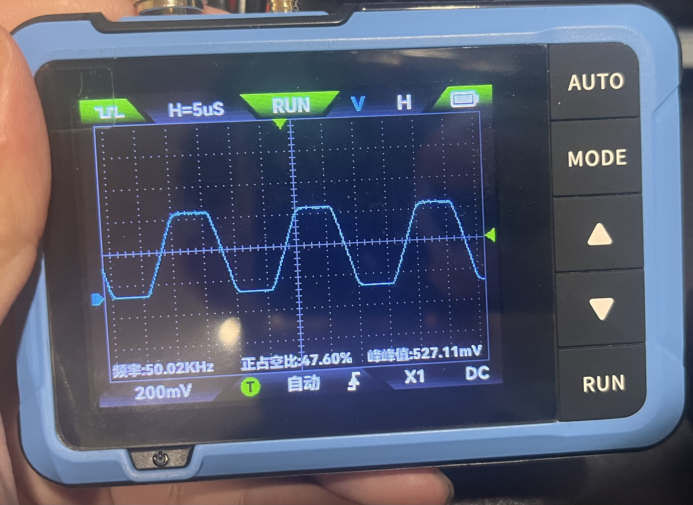
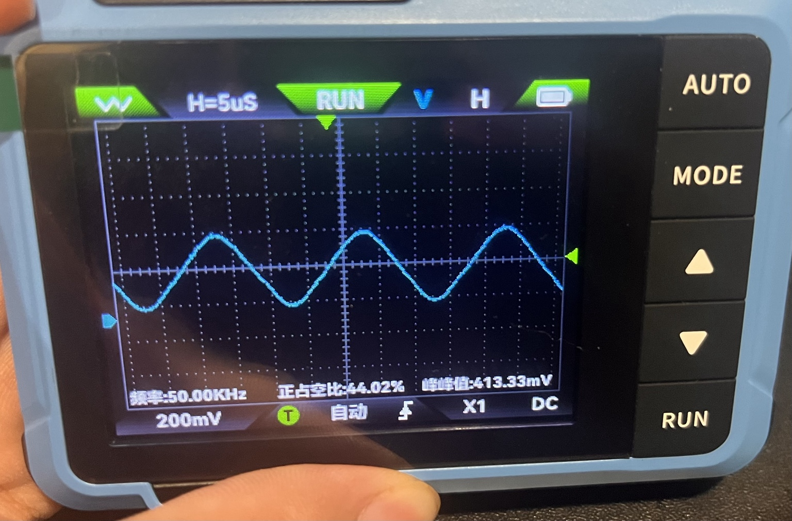

# Red Pitaya FPGA Moving Average Verification

This repository documents a hardware verification experiment for a moving average filter on the Red Pitaya FPGA platform.

The project is based on the official Red Pitaya FPGA moving average example.  
The main modified file is:

```text
src/moving_average.vhd
```

The focus of this project is not to rebuild the entire Red Pitaya FPGA system, but to modify the moving average filter and verify the ADC-to-FPGA-to-DAC signal path on real hardware.

---

## Project Goal

The goal of this experiment is to verify that an external analog signal can be sampled by the Red Pitaya ADC, processed by a custom FPGA moving average filter, and output through the DAC.

Signal path:

```text
External Signal Generator
        ↓
Red Pitaya IN2
        ↓
ADC
        ↓
FPGA Moving Average Filter
        ↓
DAC
        ↓
Red Pitaya OUT1
        ↓
External Oscilloscope
```

---

## Test Equipment

- Red Pitaya 125-14
- External signal generator
- FNIRSI DSO-510 oscilloscope
- Vivado
- VHDL

---

## Main Modification

The original Red Pitaya moving average example uses a tag-controlled small-window moving average structure.

This version modifies `moving_average.vhd` into a fixed 512-tap moving average filter.

Main changes:

1. Extended the original small-window moving average structure to a fixed 512-tap filter.
2. Increased the accumulator width from 14-bit to 26-bit to prevent overflow.
3. Replaced direct summation with a rolling-sum implementation.
4. Used a circular buffer to store the latest 512 ADC samples.
5. Divided the accumulated sum by 512 using a 9-bit right shift.

---

## Why 512 Taps?

The Red Pitaya ADC sampling rate is 125 MHz, so the sampling period is:

```text
Ts = 1 / 125 MHz = 8 ns
```

For a 512-tap moving average filter:

```text
512 × 8 ns = 4.096 µs
```

For a 50 kHz waveform:

```text
Period = 1 / 50 kHz = 20 µs
Half period = 10 µs
```

Therefore, the 512-tap averaging window is:

```text
4.096 µs / 20 µs = 20.48% of the full period
4.096 µs / 10 µs = 40.96% of the half period
```

Compared with the original 3-tap filter:

```text
3 × 8 ns = 24 ns
```

The 3-tap averaging window is too short to produce a clearly visible smoothing effect at 50 kHz.  
By increasing the filter length to 512 taps, the smoothing effect becomes much easier to observe on an oscilloscope.

---

## Hardware Verification Results

All waveforms were tested at 50 kHz using an external signal generator and observed with an FNIRSI DSO-510 oscilloscope.

### Hardware Connection



### 3-tap Moving Average

The original 3-tap moving average filter has a very short averaging window, so the waveform remains close to the original signal.





### 512-tap Moving Average

The modified 512-tap moving average filter produces a visible low-pass filtering effect.  
The smoothing effect is especially clear on the square wave, where the rising and falling edges become less sharp.





---

## Debugging Notes

During the experiment, the simulation result was correct, but the initial hardware test did not produce the expected output.

At first, the Red Pitaya Web Scope was used to observe the signal. However, this caused confusion because the Web Scope service could interfere with the custom FPGA bitstream or affect the expected signal path.

The issue was resolved by using an external measurement setup:

- External signal generator as the input source
- Red Pitaya IN2 as the ADC input
- Red Pitaya OUT1 as the DAC output
- External oscilloscope to observe the output waveform

This confirmed that the custom FPGA bitstream could correctly process the ADC input and output the filtered result through the DAC.

---

## Repository Structure

```text
RedPitaya-FPGA-Moving-Average-Verification/
├── README.md
├── LICENSE
├── src/
│   └── moving_average.vhd
├── notes/
│   └── debug_notes.md
└── images/
    ├── hardware_setup_redpitaya_connection.jpg
    ├── 3tap_square_50khz.jpg
    ├── 3tap_triangle_50khz.jpg
    ├── 512tap_square_50khz.jpg
    └── 512tap_triangle_50khz.jpg
```

---

## Attribution

This project is based on the official Red Pitaya FPGA project:

https://github.com/RedPitaya/RedPitaya-FPGA

The original Red Pitaya FPGA source code is released under the BSD license.

This repository is not officially endorsed by Red Pitaya.

---

## License

The original Red Pitaya source code is distributed under the BSD license.  
The original copyright notice and license terms are included in this repository.

The modified `moving_average.vhd` file in this repository is based on the official Red Pitaya moving average example and includes additional modifications for the 512-tap moving average hardware verification experiment.